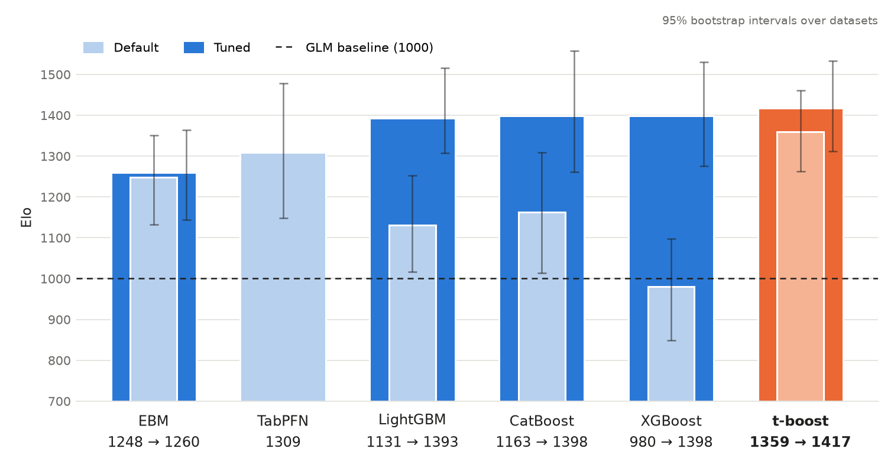

# InsurArena

A **TabArena-style benchmark of tabular modelling techniques on insurance-pricing datasets.**

It answers a simple question: **how do different modelling techniques (GLM, GBM, …) perform across
real insurance datasets?** Models are scored on Poisson/Gamma/Tweedie deviance, exposure-weighted
Gini, and calibration, not RMSE/accuracy.

## What it is

- **It is** a clean comparison of modelling *techniques* on *many* insurance datasets, with
  actuarially-correct metrics and exposure handling. TabArena's methodology, adapted for insurance.
- **One fitted model per split** - no benchmark-level bagging, blending, or stacking. Each entry is
  a single model, the unit you would actually deploy.

## Methodology and results

### Methodology

**Datasets.** 40 real insurance and adjacent datasets (no synthetic data), from 1,000 to 678,013
rows: 13 frequency, 10 classification, 6 severity, 6 pure premium and 5 multiclass. These are the 40
of the 45 sourced datasets that meet the size policy of at least 1,000 modelled rows and 4
predictors. Data is fetched from OpenML, Rdatasets and CASdatasets at run time and never re-hosted
here. The catalog is in [DATASETS.md](./DATASETS.md), with per-dataset notes in `dataset_notes/`.

**Competitors.** Twelve in total. GLM (automated binning and one-hot encoding) and TabPFN 3 (through
its hosted API) run at defaults only. LightGBM, XGBoost, CatBoost, EBM and t-boost run both at
defaults and tuned.

**Splits.** Repeated 3-fold cross-validation, the same for every model: 30 splits (3 folds × 10
repeats) for the 5 datasets under 2,500 groups, and 9 splits (3 × 3) for the other 35. Folds keep
groups such as policies together, and are stratified where the dataset declares it.

**One model per split.** Each score comes from one model fitted on that split's training data, with
no benchmark-level bagging, blending or stacking. t-boost bags inside its own fit, but that collapses
into a single table, so it still counts as one fitted model.

**Tuning.** Tuning is nested: each tuned model searches separately inside every outer training
split. Each search covers 25 candidate configurations plus the default, compared by 3-fold
out-of-fold validation that is repeated on small datasets. CatBoost, LightGBM, XGBoost and EBM use
TabArena's search spaces, and t-boost uses its own. A candidate only replaces the default if it beats
it by more than one standard error of the paired fold differences. The one step done before splitting
is dropping constant and duplicate columns, using the features alone.

**Scoring.** Every model goes through the same metric code. The primary metric is the task's
deviance: Poisson for frequency, Gamma for severity, Tweedie (power 1.9) for pure premium, log-loss
for classification and multinomial log-loss for multiclass. Frequency and pure premium are weighted
by exposure, and severity by claim count. Each score is reported as skill against the `glm/default`
baseline, where positive means better than the GLM:

    skill = 1 - D_model / D_GLM

Exposure-weighted Gini and calibration (balance, total predicted over total actual) are reported as
secondary metrics.

**Ranking.** Models are compared pairwise on each dataset's mean skill. Those wins are fitted with a
Bradley-Terry model and put on an Elo scale with `glm/default` fixed at 1000. Intervals are 95%
bootstrap intervals over datasets. The tuning protocol is described in full in
[docs/nested-campaign.md](docs/nested-campaign.md).

### Results



| Competitor | Elo | Interval | Mean rank | Median skill vs GLM | Beats the GLM on | Best on | Median Gini | Median calibration error |
|---|---:|---:|---:|---:|---:|---:|---:|---:|
| `t-boost/tuned` | 1417 | 1311 to 1533 | 4.2 | +2.3% | 37 of 40 | 3 | 0.336 | 0.1% |
| `catboost/tuned` | 1398 | 1261 to 1558 | 4.5 | +1.4% | 34 of 40 | 8 | 0.341 | 1.3% |
| `xgboost/tuned` | 1398 | 1275 to 1530 | 4.5 | +1.5% | 34 of 40 | 4 | 0.341 | 1.1% |
| `lightgbm/tuned` | 1393 | 1307 to 1515 | 4.6 | +1.8% | 37 of 40 | 4 | 0.347 | 0.4% |
| `t-boost/default` | 1359 | 1262 to 1461 | 5.0 | +1.8% | 37 of 40 | 3 | 0.335 | 0.1% |
| `tabpfn3/default` | 1309 | 1148 to 1478 | 5.8 | +0.9% | 32 of 40 | 13 | 0.274 | 1.2% |
| `ebm/tuned` | 1260 | 1144 to 1364 | 6.5 | +1.1% | 34 of 40 | 2 | 0.333 | 0.2% |
| `ebm/default` | 1248 | 1132 to 1351 | 6.7 | +1.1% | 35 of 40 | 1 | 0.333 | 0.1% |
| `catboost/default` | 1163 | 1013 to 1309 | 7.9 | +1.0% | 28 of 40 | 1 | 0.332 | 1.0% |
| `lightgbm/default` | 1131 | 1016 to 1253 | 8.3 | +0.8% | 27 of 40 | 0 | 0.339 | 0.6% |
| `glm/default` | 1000 | anchor | 9.9 | 0.0% | - | 1 | 0.272 | 0.1% |
| `xgboost/default` | 980 | 848 to 1098 | 10.1 | +0.0% | 20 of 40 | 0 | 0.335 | 2.4% |

Mean rank is across all 12 competitors on each dataset (1 is best). Skill, Gini and calibration are
medians across datasets. Gini covers the 25 frequency, severity and pure-premium datasets.
Calibration error is `|balance - 1|` on the 35 non-multiclass datasets.

- **The top four are a statistical tie.** `t-boost/tuned` leads at 1417, but its interval (1311 to
  1533) overlaps heavily with tuned CatBoost, XGBoost and LightGBM.
- **Tuning matters most for the standard boosting libraries.** It adds 418 Elo for XGBoost, 262 for
  LightGBM and 235 for CatBoost, against 58 for t-boost and 12 for EBM.
- **Defaults vary widely.** `t-boost/default` (1359) sits close to the tuned models, while
  `xgboost/default` (980) is the only competitor below the GLM.
- **TabPFN 3 is strong but uneven.** With no tuning it is the best model on 13 of 40 datasets, yet it
  ranks sixth overall (1309).
- **Typical gains over the GLM are modest and depend on the task.** Among the top four, median skill
  is about 8% on classification, 5% on severity, 1.2% on frequency and under 1% on pure premium.

Median skill by task, with the number of datasets in brackets:

| Competitor | Frequency (13) | Severity (6) | Pure premium (6) | Classification (10) | Multiclass (5) |
|---|---:|---:|---:|---:|---:|
| `t-boost/tuned` | +1.2% | +5.2% | +0.8% | +8.2% | +2.4% |
| `catboost/tuned` | +1.2% | +5.5% | +0.5% | +8.2% | +2.7% |
| `xgboost/tuned` | +1.2% | +5.0% | +0.1% | +8.3% | +2.6% |
| `lightgbm/tuned` | +1.2% | +5.2% | +0.6% | +8.3% | +1.9% |
| `t-boost/default` | +1.2% | +4.1% | +0.8% | +7.8% | +1.5% |
| `tabpfn3/default` | +0.2% | +5.6% | -0.6% | +6.8% | +2.7% |
| `ebm/tuned` | +1.2% | +2.6% | -2.0% | +6.3% | +0.8% |
| `ebm/default` | +1.2% | +2.4% | -1.2% | +6.2% | +0.6% |
| `catboost/default` | +0.4% | +5.3% | -10.0% | +7.9% | +2.6% |
| `lightgbm/default` | +1.1% | +1.3% | -2.0% | +7.2% | +0.4% |
| `glm/default` | 0.0% | 0.0% | 0.0% | 0.0% | 0.0% |
| `xgboost/default` | +0.1% | -1.1% | -14.1% | +7.2% | +0.3% |

**Reading these results**

- A few fits diverged on Tweedie pure-premium data, including `xgboost/default` on `ausprivauto_pp`
  and `catboost/tuned` on `brvehins1_pp`. In all, 34 of the 5,580 scores have skill below -50%, which
  would dominate any mean, so these tables use medians and ranks.
- The board combines several runs on the same splits and data: t-boost on engine 0.6.0, the other
  models in a 2026-09-09 rebuild, and `fremotor_prem` and `euhealth_pp` rerun for every model after
  a split fix.

## Running it

With [uv](https://docs.astral.sh/uv/) installed:

```bash
uv sync --extra gbm --extra io --extra dev
uv run python -m insurarena.cli run --config configs/smoke.yaml    # offline synthetic, seconds
uv run python -m insurarena.cli run --config configs/lite.yaml     # real freMTPL2freq (frequency)
uv run python -m insurarena.cli run --config configs/stretch.yaml  # freq + severity + pure-prem + classification
uv run pytest -q                                                   # offline tests
```

Results are cached per cell (dataset × model × variant × split), so re-running after adding a model
or dataset only computes the new work. Adding a dataset is one `DatasetEntry` row in
`datasets/manifest.py` (see [DATASETS.md](./DATASETS.md)), and adding a technique is one adapter
file. The full design is in [SPEC.md](./SPEC.md).

## What's in the repo

| Path | What it holds |
|---|---|
| `src/insurarena/` | The engine: dataset loaders + manifest, splitting, metrics, HPO, and one file per model adapter. |
| `configs/` | Four quick profiles (`smoke`, `lite`, `stretch`, `full`) plus **one campaign config per model**, named for the model it runs: `catboost.yaml`, `ebm.yaml`, `lightgbm.yaml`, `t-boost.yaml`, `xgboost.yaml`. Each covers all 40 eligible datasets and is what produced the published board. |
| `results/` | The published board - `leaderboard_cells.csv` (one row per cell), `leaderboard_cells_detail.csv` (secondary metrics and timings for the same cells), `elo_ladder.csv`, `elo_chart.png`. |
| `scripts/` | `elo_ladder.py` (build/print the ladder), `resolved_report.py`, `validate_datasets.py`, `gen_dataset_notes.py`. |
| `dataset_notes/` | Per-dataset provenance, shaping and hygiene notes, generated from the manifest. |
| `tests/` | Offline tests - metrics, splitting, adapters, and the HPO/gate protocol invariants. |
| `SPEC.md`, `DATASETS.md` | The methodology and the dataset catalog. |

`runs/` is local run state (per-cell caches, fetched data, predictions) and is not tracked; the
committed `results/` table is the published form. Modelled on TabArena
([arXiv:2506.16791](https://arxiv.org/abs/2506.16791)).

## Benchmark your model

Every published score is in **`results/leaderboard_cells.csv`** - ONE row per
`(model, variant, dataset, split_id)`, with `skill_vs_glm`, the primary metric and its value,
`n_train`/`n_test`, the split `seed`, and the dataset `source_hash`. That file is the comparison
surface: you do not need our per-cell caches (they are not in git).

`results/leaderboard_cells_detail.csv` has the same rows in the same order, with Gini, calibration
and the other secondary metrics (`sec_*`; which ones apply depends on the task) plus run times.
Timings are operational measurements from the accuracy runs, not isolated benchmarks, and `tabpfn3`
runs on a hosted API.

```bash
git clone <this repo> && cd insur-arena
uv sync --extra all --extra viz --extra dev --extra t-boost
uv run pytest -q                                # offline; no downloads
```

Tests that exercise an optional engine fail rather than skip when it is missing. With the extras
above, this is the green run:

```bash
uv run pytest -q --ignore=tests/test_rustystats_adapter.py \
  --deselect "tests/test_adapters.py::test_adapter_conformance[tabdpt]" \
  --deselect "tests/test_adapters.py::test_adapter_conformance[tabicl]" \
  --deselect "tests/test_adapters.py::test_adapter_conformance[rustystats]" \
  --deselect "tests/test_campaign_evidence.py::test_numeric_reconstruction_includes_real_three_way_boxes_and_boundaries"
```

`tabdpt` and `tabicl` are optional engines the extras do not install. The `rustystats` adapter is
deselected too: it is an optional GLM engine, is not on the published board, and does not currently
fit against `rustystats==0.8.13` (`prior_weight` typing, `rustystats_model.py:453`). The
reconstruction test passes on t-boost 0.6.0, the engine behind the board, but its small fixture no
longer builds factored tables on 0.9.1.

**Datasets are fetched at load time** from OpenML / Rdatasets / CASdatasets - nothing is re-hosted
here, so a first run needs network. No credentials are required for those three; CASdatasets `.rda`
files need the `casdata` extra (`rdata`). TabPFN3 is the one gated comparator (license acceptance +
`TABPFN_TOKEN`).

**Splits are deterministic and dataset-derived.** For dataset `D`:

```python
from insurarena.datasets.registry import build_loader
from insurarena.eval.splitting import outer_splits
from insurarena.seeds import seed_for
bundle = build_loader("credit_g", cache_dir="runs/benchmark").load()
splits = outer_splits(bundle, {"small_threshold": 2500, "small": {"folds": 3, "repeats": 10},
                               "large": {"folds": 3, "repeats": 3}}, seed_for("credit_g"))
```

`seed_for(D)` is a SHA-256 hash of the dataset name (no arithmetic seeds), and the schedule block is
the `split:` section of the campaign configs (`configs/t-boost.yaml` et al): under
2,500 groups → 3×10 = **30 splits**, otherwise 3×3 = **9 splits**. Folds are group-honest and
stratified where the bundle declares it (`GroupKFold` / `StratifiedGroupKFold` / `StratifiedKFold`).
`split_id` is the position in that list, so split *k* here is split *k* there. Check
`bundle.meta["hash"]` against the `source_hash` column before comparing.

**Two ways to compete.** Either add an adapter - one file in `src/insurarena/models/`, one line in
`src/insurarena/models/registry.py`, then run `uv run python -m insurarena.cli run --config <your.yaml>`
- or fit externally on each `(train_idx, test_idx)` and score yourself. The metric is
**skill vs the frozen GLM baseline**, per split:

    skill_vs_glm = 1 - D_model / D_GLM

where `D` is the task's primary deviance on the test fold (Poisson / Gamma / Tweedie / Bernoulli /
multinomial - see `insurarena.metrics.deviance`). Reuse our `D_GLM` rather than refitting it: the
`glm/default` row for that `(dataset, split_id)` carries it directly as `primary_value` (its own
skill is 0 by construction); from any other row, `D_GLM = primary_value / (1 - skill_vs_glm)`.
Positive beats the GLM; the ladder aggregates the per-split mean per dataset.

**Then place yourself on the ladder.** Append your rows (same columns, `model`/`variant` of your
choosing) and recompute:

```bash
uv run python scripts/elo_ladder.py --cells results/leaderboard_cells.csv   # ladder from the table alone
uv run python scripts/elo_ladder.py --export results                        # re-extract from runs/benchmark
```

`results/elo_ladder.csv` holds the current Bradley-Terry Elo (bootstrap CIs, `glm/default` = 1000)
and `results/elo_chart.png` is rendered from that same table.

## License

MIT - see [LICENSE](./LICENSE). Datasets are fetched from their origins under their own terms;
none are re-hosted here.
